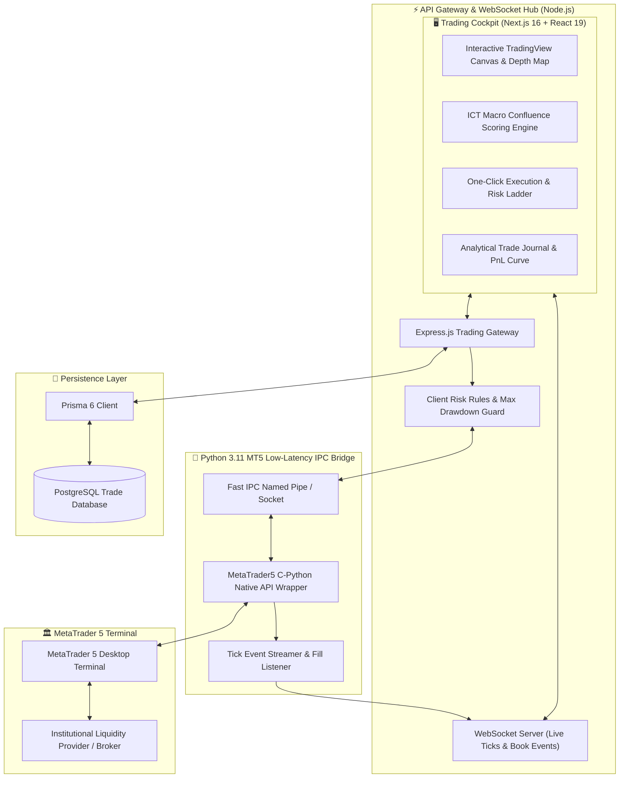
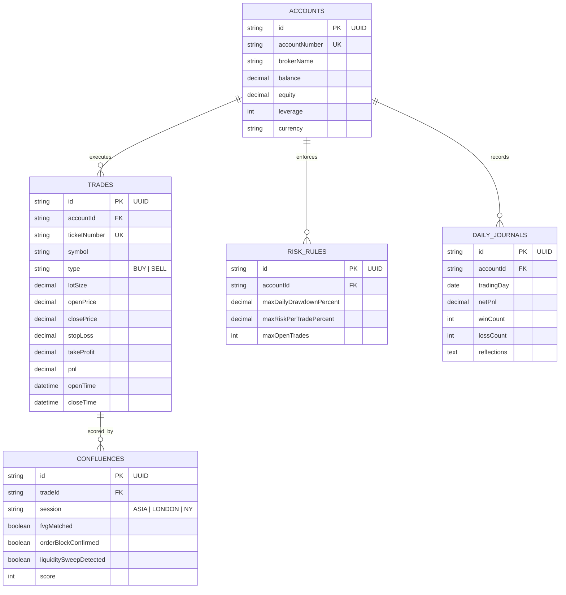
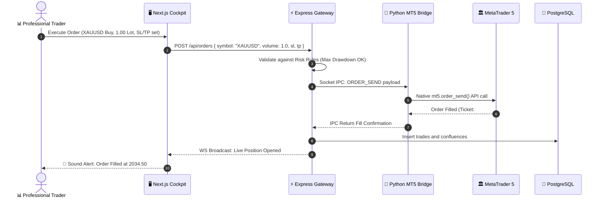

# 📈 Journex — Institutional Trading Cockpit & Adaptive ICT Engine

<div align="center">


**High-frequency algorithmic trading intelligence desk, live MetaTrader 5 IPC socket bridge, macro liquidity confluence analytics, and automated ICT execution workspace.**

[System Architecture](#-system-architecture) • [Database ERD](#-database-erd) • [Execution Flow](#-algorithmic-execution--journal-flow) • [Quick Start](#-quick-start)

</div>

---

## ⚡ Overview

**Journex** transforms raw financial market data into high-probability execution setups. It connects a reactive Next.js trading cockpit with a dedicated low-latency Python IPC bridge interfacing directly with **MetaTrader 5 (MT5)**, providing sub-millisecond execution, automated risk parameters, and an institutional trade journal.

---

## 🏗️ System Architecture



---

## 📊 Database ERD



---

## 🔄 Algorithmic Execution & Journal Flow



---

## 🚀 Quick Start

### 1. Start Python MT5 IPC Bridge (Windows)
```bash
cd backend/python
pip install -r requirements.txt
python mt5_bridge.py
```

### 2. Start Gateway & Cockpit
```bash
cd ../..
pnpm install
pnpm run dev
```

Visit `http://localhost:3000` to launch the Journex cockpit.

---

## 📄 License
Proprietary & Confidential — Engineered by **[Ros Rendo](https://github.com/RosRendo)**
