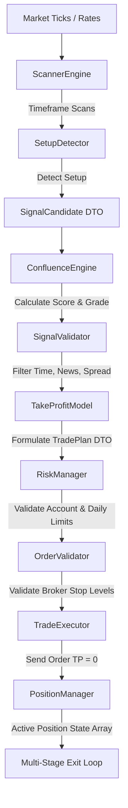

# AdaptiveICT Expert Advisor — Complete Technical Manual
> **Platform:** MetaTrader 5 (MQL5)  
> **Refactored Version:** 1.1 (Modular & Decoupled Architecture)  
> **Asset Class:** Forex / Indices / Commodities (Optimized for EURUSD H1)  
> **Strategy Style:** ICT / Smart Money Concepts (SMC) + Momentum Filters  

---

## 1. System Vision & Decoupled Architecture
The **AdaptiveICT** Expert Advisor is designed on professional, institutional-grade algorithmic trading principles. Instead of keeping all logic inside a monolithic file, the system separates concerns into discrete modules for signal detection, confluence evaluation, risk control, trade entry execution, and position management.

This prevents the compiler from binding detection directly to execution, enabling modular testing and safe, state-persistent execution.

### Decoupled Data & Dependency Pipeline


---

## 2. Directory & Module Tour
The codebase is structured under `mql5/AdaptiveICT/` as follows:

*   **`Core/`**: The system's core. Holds custom types, configuration variables, state managers, and the master system controller.
*   **`Scanner/`**: Multi-timeframe scan loop that monitors chart symbols across M5, M15, H1, and H4 timeframes, looking for valid SMC structure shifts.
*   **`ICT/`**: Contains the mathematical and swing-based criteria for ICT/SMC concepts: Market Structure Shifts (MSS), Fair Value Gaps (FVG), Order Blocks (OB), Liquidity Sweeps, and SMT Divergences.
*   **`Indicators/`**: Handlers for all technical filters (RSI, ADX, ATR, EMA, VWAP, Volume).
*   **`Market/`**: Controls chart settings, market sessions (London vs. NY), spreads, and trend regime calculations.
*   **`Risk/`**: Holds position size calculators, daily loss drawdown guards, and maximum concurrent exposure limits.
*   **`Targets/`**: Translates valid signals into specific structural entries, stop loss invalidation points, and target zones (TP1, TP2, TP3).
*   **`Execution/`**: Manages broker compliance checks, ensuring dynamic stop distances conform to broker-defined limit floors.
*   **`Trade/`**: Implements basic market actions and houses the active, tick-by-tick position supervisor class.
*   **`Communication/`**: Handles the JSON parser and Windows WebRequest HTTP clients that sync terminals to the Python flask dashboard.
*   **`Dashboard/`**: Orchestrates high-frequency graphical overlays directly on the MT5 main chart.
*   **`Utils/`**: Diagnostic helpers, log wrappers, mathematical functions, and time converters.

---

## 3. Key Struct Definitions (`Core/Types.mqh`)

### `SignalCandidate`
Defines a potential market setup detected by the scanner before filter validations.
```mql5
struct SignalCandidate {
   string   symbol;
   string   type;                 // "BUY" or "SELL"
   double   entry_price;
   double   invalidation_price;    // Raw structural SL level
   double   confidence;           // Score from ConfluenceEngine (0-100)
   string   timeframe;
   string   setup_type;           // Setup criteria (e.g. "ICT_MSS_OB")
   bool     htf_aligned;          // True if HTF trend matches signal direction
   string   reason;               // Context log
};
```

### `TradePlan`
Defines a validated setup ready for execution, complete with multi-target levels.
```mql5
struct TradePlan {
   string   symbol;
   string   type;                 // "BUY" or "SELL"
   double   entry_price;
   double   sl;                   // Normalized entry Stop Loss
   double   tp1;                  // Take Profit Target 1 (33% close trigger)
   double   tp2;                  // Take Profit Target 2 (50% of remainder close)
   double   tp3;                  // Take Profit Target 3 (100% of final remainder close)
   int      confidence;           // Confluence Score (0-100)
   string   signal_id;            // Unique string: Symbol-Timeframe-BarTime-Direction
   string   grade;                // Quality Grade (A / B / C)
   string   reasoning;            // Technical description
};
```

### `MqlPositionState`
Stored in the state array to track active positions and manage exits dynamically across ticks.
```mql5
struct MqlPositionState {
   ulong    ticket;               // Position ticket identifier
   bool     tp1_hit;              // Flag: True if TP1 has been scaled out
   bool     tp2_hit;              // Flag: True if TP2 has been scaled out
   double   original_sl;          // Stored initial stop price
   double   tp1;                  // TP1 level
   double   tp2;                  // TP2 level
   double   tp3;                  // TP3 level
};
```

---

## 4. Multi-Stage Trade Execution & Exit Model
In order to maximize target capture and reduce dependency on broker execution lags, **orders are sent to the market with a Target Profit (TP) of zero.** 

The EA's `PositionManager.mqh` monitors open positions on every tick and executes target closures internally:

1.  **Entry Execution**: The `TradeExecutor` opens the position with a strict broker-side Stop Loss, but **TP = 0**. It registers the initial parameters in the global state array.
2.  **Stage 1 (TP1 Close & BE Guard)**: Once price hits `tp1` (1.5R distance), the EA:
    *   Closes **33%** of the position volume.
    *   Moves the Stop Loss of the remaining 67% volume to **Entry Price + 5 pips** (Breakeven + Buffer). This buffer prevents spread noise from immediately stopping out the remainder.
3.  **Stage 2 (TP2 Close)**: If price continues to `tp2` (3R distance), the EA closes **50% of the remaining volume** (approx. 33% of the initial position).
4.  **Stage 3 (TP3 Close)**: If price reaches `tp3` (5R distance), the EA closes **100% of the final remainder**.
5.  **Stage 4 (ATR Trailing Stop)**: If trailing is enabled, an ATR-based trailing stop (`InpTrailATRMult` × ATR) actively tracks behind the remaining volume once Stage 1 has completed.
6.  **State Synchronization**: `CleanupPositionStates()` runs on every tick to clean up closed position tickets from the state tracking array, maintaining system performance.

---

## 5. Input Configurations & Constraints (`Core/Config.mqh`)

### 1. Risk & Trade Management
*   `InpStrategyType` (Default: `STRATEGY_ICT`): Selected Strategy type (`STRATEGY_ICT` or `STRATEGY_MOMENTUM`).
*   `InpPositionMode` (Default: `MODE_SINGLE`): Selected Exit management mode (`MODE_SINGLE` or `MODE_GRID`).
*   `InpRiskPercent` (Default: `1.0`): Percentage of account equity risked on a single trade. Used to compute variable lot sizes based on Stop Loss distance.
*   `InpMaxDailyLossPct` (Default: `3.0`): Maximum percentage drawdown on account balance per day before the EA stops executing new signals.
*   `InpMaxOpenTrades` (Default: `2`): Maximum concurrent open positions allowed at once.
*   `InpMinRR` (Default: `2.0`): Rejects setup entries if the risk-to-reward ratio (Entry to TP1 divided by Entry to SL) is less than 2.0.
*   `InpUseBE` (Default: `true`): Enables the automatic breakeven modification when TP1 is hit.
*   `InpTrailingStop` (Default: `true`): Enables trailing Stop Loss adjustments once the position is in profit.

### 2. Scanning & Indicators
*   `InpMinScore` (Default: `75`): Minimum score required from the ConfluenceEngine (scale 0-100) to trade a setup.
*   `InpMinSLPips` (Default: `15`): Rejects setup candidates with stop distances below 15 pips, preventing extremely small stops from triggering oversized lots that fail during minor spread spikes.
*   `InpVolMinRatio` (Default: `1.5`): Rejects trades if the entry candle volume is less than 1.5× the average volume of the previous 20 candles.
*   `InpUseSMT` (Default: `true`): Activates SMT divergence checks against `InpSMTSymbol` (e.g. comparing EURUSD swings against GBPUSD).

### 3. Dashboard Display Settings
*   `InpShowDashboard` (Default: `true`): Toggles rendering of the on-chart status table overlay.
*   `InpDashboardCorner` (Default: `CORNER_LEFT_UPPER`): Anchor corner for on-chart overlay panel placement.
*   `InpDashboardX` (Default: `15`): Horizontal layout pixel offset from the selected corner.
*   `InpDashboardY` (Default: `20`): Vertical layout pixel offset from the selected corner.

---

## 6. Python REST Bridge Integration (`Communication/`)
The EA exchanges JSON payloads with the Flask Bridge running at `InpBridgeURL` (default: `http://127.0.0.1:5003`).

*   `GET /api/ea/settings/{magic}`: Syncs settings and controls from the Python web panel.
*   `POST /api/ea/heartbeat`: Relays account health, current equity/balance, and active trade list to the dashboard.
*   `POST /api/ea/signal-detected`: Sends real-time scanner setup alerts to the bridge for logging and telegram notifications.
*   `POST /api/ea/trade-event`: Sends detailed transaction events (Order Open, SL modification, partial close, full close) to the bridge.

---

## 7. Backtest Evolution & Findings

Through three iterations of backtesting on the EURUSD H1 chart (Jan 01 – Aug 10, 2026), the system was optimized from an unstable monolithic architecture to a precise, low-drawdown decoupled system.

| Metric | Run 1 (Monolith EA) | Run 2 (First Refactor) | Run 3 (TP & Buffer Optimization) |
| :--- | :--- | :--- | :--- |
| **Trade Selector** | `AdaptiveICT_EA` | `AdaptiveICT` | `AdaptiveICT` |
| **Total Trades** | 2,043 | 390 | **292** |
| **Win Rate** | 84.43% | 72.82% | **69.86%** |
| **Avg Win / Loss** | $13.30 / -$82.47 | $27.39 / -$85.21 | **$33.46 / -$96.09** |
| **Max Drawdown** | 39.14% | 20.11% | **24.44%** |
| **Profit Factor** | 0.875 | 0.861 | **0.807** |
| **Net Outcome** | -$3,283.47 | -$1,253.72 | **-$1,628.93** |

### Key Takeaways
1.  **Duplicate Signal Fix**: Shifting from `TimeCurrent()` to a unique bar-start-time signal ID cut total trade counts by **85%**, preventing multiple entries on the same chart candle.
2.  **The Expectancy Trap**: Running a 1:1 TP1 exit and immediately moving Stop Loss to exact entry resulted in an inverse risk-to-reward ratio (most wins closed at +0.5R, while losses took a full -1.0R hit).
3.  **Run 3 Progress**: Increasing TP1 to 1.5R boosted average win sizes by **22%**. However, because the user-defined `InpMinRR` (1.5) and `InpMinScore` (70) tester inputs were carried over from saved caching instead of applying the new `Config.mqh` defaults, the filter thresholds did not tighten.

---

## 8. Deployment & Execution Checklist

### Step 1: File Copy
Copy the local repository folder:
`d:\FOR RENDO (ONLY )\Personal Project\Dashboard\mql5\AdaptiveICT\`  
Into your MetaTrader 5 Experts folder:  
`C:\Users\<User>\AppData\Roaming\MetaQuotes\Terminal\<Terminal_ID>\MQL5\Experts\AdaptiveICT\`

### Step 2: WebRequest Authorization
In MT5: Go to **Tools** → **Options** → **Expert Advisors**.
1. Check **"Allow WebRequest for listed URL:"**
2. Add: `http://127.0.0.1:5003`

### Step 3: Compilation
Open `AdaptiveICT.mq5` in MetaEditor and press **F7**. Verify that the bottom console shows `0 error(s), 0 warning(s)`.

### Step 4: Launching parameters
When launching a backtest or attaching to a live chart, go to the **Inputs** tab and manually reset/configure:
*   `InpMinRR` = **2.0**
*   `InpMinSLPips` = **15**
*   `InpMinScore` = **75**
*   `InpMaxOpenTrades` = **2**
