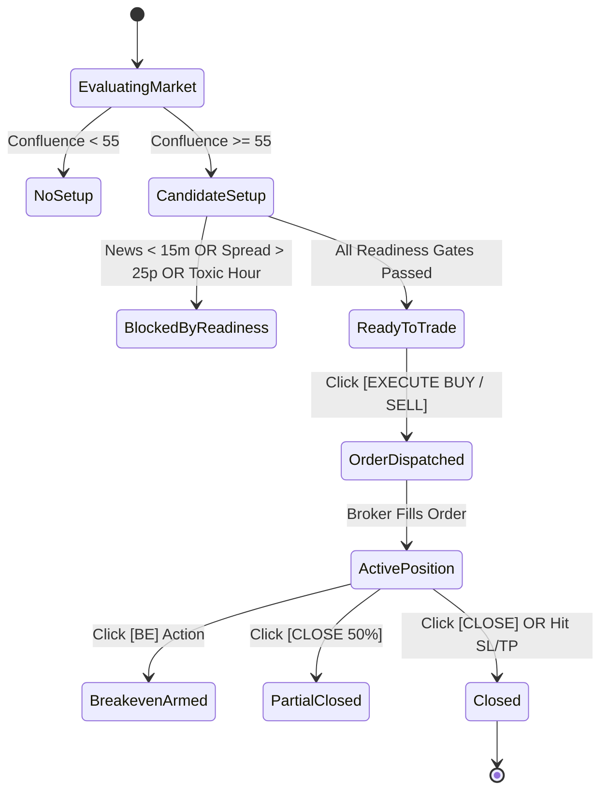

# Data Model: Terminal Cognitive Hierarchy & Execution Engine

**Feature**: `002-terminal-live-intelligence`  
**Date**: 2026-09-20  
**Status**: Completed

---

## 1. Core Data Entities

### 1.1 SignalHeroSnapshot
Represents the current instantaneous decision state displayed in the Level 1 Hero Card.

```typescript
export interface SignalHeroSnapshot {
  symbol: string;               // e.g. "XAUUSD"
  timeframe: string;            // e.g. "M15"
  state: "ACTIVE_SETUP" | "NO_VALID_SETUP";
  signalType: "BUY" | "SELL" | "NEUTRAL";
  confluenceScore: number;      // 0 - 100
  grade: "A+" | "A" | "B" | "C" | "F";
  entryPrice?: number;
  slPrice?: number;
  tp1Price?: number;
  tp2Price?: number;
  waitingReasons?: string[];    // populated when state is NO_VALID_SETUP
  timestamp: string;            // ISO8601
}
```

### 1.2 ConfluenceBreakdown
Represents the Level 2 factor-by-factor breakdown explaining the signal validity.

```typescript
export interface ConfluenceBreakdown {
  totalScore: number;           // 0 - 100
  grade: "A+" | "A" | "B" | "C" | "F";
  factors: {
    liquidity: { score: number; max: 20; label: string; passed: boolean };
    marketStructure: { score: number; max: 20; label: string; passed: boolean };
    fvgOrderBlock: { score: number; max: 15; label: string; passed: boolean };
    mtfAlignment: { score: number; max: 15; label: string; passed: boolean };
    momentum: { score: number; max: 15; label: string; passed: boolean };
    volume: { score: number; max: 10; label: string; passed: boolean };
  };
  whyValid: string[];           // Affirmative reasons (e.g. ["Sell-side liquidity swept", "Bullish CHoCH confirmed"])
  warnings: string[];           // Active warnings (e.g. ["NY news in 18 minutes", "Spread slightly elevated"])
}
```

### 1.3 ChartStructuralLandmark
Represents structural objects overlaid directly on the Level 3 Candlestick Canvas.

```typescript
export interface ChartStructuralLandmark {
  id: string;
  type: "BOS" | "CHOCH" | "FVG" | "ORDER_BLOCK" | "LIQUIDITY_SWEEP" | "TRADE_PROJECTION";
  bias: "BULLISH" | "BEARISH";
  timeStart: number;            // epoch timestamp
  timeEnd?: number;
  priceHigh: number;
  priceLow: number;
  label: string;
  color?: string;
  meta?: {
    entry?: number;
    sl?: number;
    tp1?: number;
    tp2?: number;
  };
}
```

### 1.4 ExecutionReadinessGate
Represents the Level 4 pre-trade safety audit.

```typescript
export interface ExecutionReadinessGate {
  status: "READY" | "BLOCKED";
  checks: {
    marketOpen: { passed: boolean; label: string };
    spread: { passed: boolean; currentPips: number; maxPips: number; label: string };
    volatility: { passed: boolean; atrPips: number; status: "NORMAL" | "ELEVATED" };
    regime: { passed: boolean; currentRegime: string; isAligned: boolean };
    mtf: { passed: boolean; htfBias: string; alignmentPct: number };
    news: { passed: boolean; nextEventMinutes: number; impact: "HIGH" | "MED" | "LOW" };
    liquidity: { passed: boolean; available: boolean };
    signal: { passed: boolean; grade: string };
  };
  sizing: {
    riskPercent: number;        // e.g. 1.0%
    accountBalance: number;
    slDistancePips: number;
    calculatedLots: number;     // e.g. 0.42
    dollarRisk: number;         // e.g. $104.20
    riskRewardRatio: string;    // e.g. "1:2.8"
  };
  blockedReasons?: string[];
}
```

### 1.5 ActivePositionEntity & CapitalTelemetry
Represents Level 5 trade lifecycle management.

```typescript
export interface ActivePositionEntity {
  ticket: number;
  symbol: string;
  type: "BUY" | "SELL";
  lots: number;
  openPrice: number;
  currentPrice: number;
  sl: number;
  tp: number;
  pnl: number;
  pnlPips: number;
  duration: string;
}

export interface CapitalTelemetryStrip {
  balance: number;
  equity: number;
  floatingPnl: number;
  marginFree: number;
  marginLevelPct: number;
  dailyPnlPct: number;
  connectionState: "LIVE" | "MOCK" | "DISCONNECTED";
  latencyMs: number;
}
```

---

## 2. State Lifecycle & Transitions


